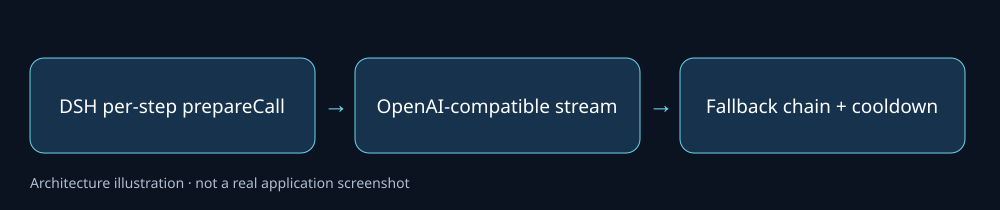

# DSH Polyglot · 0.3.6 兼容定制

基于[Jesse-njx/dsh-polyglot](https://github.com/Jesse-njx/dsh-polyglot)的本机兼容副本。保留上游多提供商路由、回退与冷却能力；本机仅在三个TypeScript源文件增加新DSH每步调用所需的`prepareCall`入口，并让可选commands服务通过Cordis注入挂载。



**状态：本地软件兼容测试通过；真实DSH 0.3.6宿主与供应商账号集成未在本次迁移重测。** 这不是DeepSeek官方核心项目，也不包含任何个人供应商配置。

## 快速运行与安装

准备Node24、pnpm10（原CI也声明pnpm11）。仓库根执行：

```powershell
pnpm install --frozen-lockfile --ignore-scripts
pnpm typecheck
pnpm build
pnpm test
```

测试使用回环地址上的模拟OpenAI兼容服务，不需要密钥或付费模型。准备自己的兼容DSH宿主后，在需要安装的独立profile中使用上游bundle安装方式：

```powershell
dsh plugin --profile web add -w C:/path/to/dsh-polyglot-compat
```

此步骤会改你选择的DSH profile；本次只在公开副本运行软件检查，没有安装到用户真实宿主。运行实际模型需要自行配置供应商凭据和服务地址；默认JSON只是上游公开preset定义，不能当作已开通账号或免费额度承诺。完整配置和模型命令见[保留的上游说明](UPSTREAM_README.md)。

## 源码与改动范围

| 路径 | 内容 |
|---|---|
| src/adapter.ts、router.ts | 模型信息与可独立调用的stream回调入口 |
| src/index.ts | 可选commands服务的作用域注入 |
| src/其余文件、presets/ | 上游实现及公开默认preset |
| test/ | 上游56项测试与新增1项prepareCall回环服务回归 |
| patches/dsh-0.3.6-compat.patch | 相对上游固定提交的原本机改动 |

上游基点`127ceefb1532afc887bd0969f4d99fbc670ac8b1`，原40个跟踪文件完整归档。私有`*-user.json`、真实DSH_HOME、依赖缓存和原Git历史未公开。编译输出`lib/`由`pnpm build`生成，源码和锁文件已保存。

## 验证与后续

2026-10-26：全新锁定安装、类型检查、编译成功；原56项测试通过，新增prepareCall用例单独通过。后续应在独立测试宿主确认新版真实调用协议，不能把旧SDK模拟测试当作所有DSH版本兼容保证。真实供应商费用、重试行为及新模型目录未验证。

上游MIT版权保留；本机定制代码和文档采用MIT。见[LICENSE](LICENSE)、[第三方登记](THIRD_PARTY_NOTICES.md)和[更新日志](CHANGELOG.md)。本地原件未改，不能据本次检查删除它。
